# jzombie-graph

Nightly self-portrait of my GitHub portfolio: real dependency edges (manifest, workflow, docs) plus a self-normalized Developer Focus gauge ranking where attention is going. Counts live in the data, not in this prose: every rebuild refreshes the proof page under `proof/` with repo and edge totals, 30d commits and comments, open and closed threads touched, and top languages. Nothing here is hand-counted.

Code and data live here together. The collector, renderers, and lanes in this repo are the program; `proof/` is its latest output, committed back by the nightly run. Reading this repo at HEAD is reading the freshest sweep: the code that produced the data sits next to the data it produced.

## Where attention is going (rebuilt nightly)

[](proof/README.md)

[](proof/README.md)

Full proof with map, flame, table, and machine-readable data: [`proof/README.md`](proof/README.md). Raw JSON: [`data/portfolio-graph.json`](data/portfolio-graph.json).

Own repo, personal scope. `publish = false` — internal tool, never published to crates.io. Private repos are stripped from default output, so the committed files are safe to publish; `--include-private` is local-briefing only and never committed.

## Quickstart

```bash
export JZOMBIE_GRAPH_TOKEN=ghp_...
cargo run -- --user jzombie                              # sweep: data/portfolio-graph.json + schema
cargo run -p jzombie-graph-cartographer                  # map fragment: proof/fragments/portfolio-graph.md
cargo run -p jzombie-graph-charts                        # share pie; add --chart focus | flame | indicators | preview
cargo run -- --format focus                              # offline focus ranking, no API calls
oxdock scripts/proof.oxfile                              # proof inputs; oxdock-render assembles proof/README.md
```

## Regenerate the JSON

```bash
export JZOMBIE_GRAPH_TOKEN=ghp_...
cargo run -- --user jzombie
```

Defaults to `--format json` into `data/portfolio-graph.json` (see `src/paths.rs` — one source of truth). The schema (`data/portfolio-graph-schema.json`) refreshes on the same run — one ingest, both copies, never a stale contract. Needs a token for API rate limits (5000/hr vs 60/hr without). Public repos need no scopes; private repos need `repo` scope and are stripped from default output. Takes a while (~24 API calls per repo). Never run with `--include-private` output committed — that flag is local-briefing only. `--stdout` prints instead of writing the file; `--output PATH` overrides the path.

## Regenerate the graph

```bash
cargo run -p jzombie-graph-cartographer
```

Local only, no API calls. Reads `data/portfolio-graph.json`, writes the clickable `<pre>` fragment to `proof/fragments/portfolio-graph.md`. Piped stdin still wins when present; `--stdout` prints instead.

## Regenerate the charts

```bash
cargo run -p jzombie-graph-charts
cargo run -p jzombie-graph-charts -- --chart focus
```

Local only, no API calls. Reads the fresh JSON, writes the commit-share pie and the focus bars to `proof/`. Colors come from the shared `charts::palette` module so every chart reads as one family; bytes pinned by snapshot tests.

## Developer Focus (offline, no API calls)

```bash
cargo run -- --format focus
```

Same `focus` the dump lane shows — commit heat vs own 30d baseline minus idle months, hottest first. Needs a recent ingest; counts freeze at collection time.

## Render proof (what GitHub actually shows)

```bash
oxdock-render
```

Assembles the committed `proof/README.md` — map fragment verbatim, all charts embedded, machine-readable commit-data table (role/proof/reuse per repo, layer-labeled, tiny topic search links, top-10 + roll-up). That page is the visual proof; `proof/` is never hand-edited. Inputs refresh via the renderer's pre-hook (`scripts/proof.oxfile`: fragment + chart lanes). All markup emission is [OxDock](https://github.com/jzombie/rust-oxdock)-templated (tables via the shared `MARKDOWN` module); assembly order lives in the template.

## Regenerate the schema

```bash
cargo run -- --format schema
```

Static, no API calls and no selector — derived from the Rust types. The nightly lands the regenerated copy automatically; locally, copy the lane output over the committed `data/portfolio-graph-schema.json` yourself. Either way the drift test fails CI if the types and the file disagree.

## Nightly rebuild (CI only)

`.github/workflows/nightly.yml` builds the workspace, installs the oxdock CLI (tracks latest), and runs `.github/scripts/pipeline.oxfile` (collect → schema → render → charts → proof → commit, fail-closed). Trigger: daily cron + manual `workflow_dispatch`. Nothing publishes: the rebuilt `proof/` commits back to the repo, gated on change — quiet sweeps push nothing.

## License

MIT OR Apache-2.0. See [`LICENSE-MIT`](LICENSE-MIT), [`LICENSE-APACHE`](LICENSE-APACHE).
