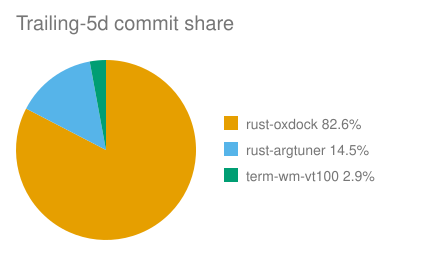
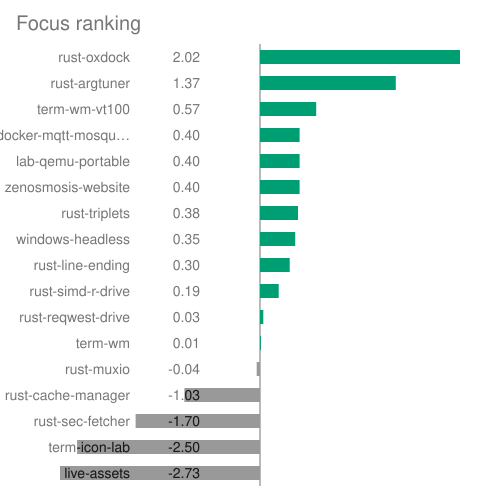

# portfolio-graph — render proof

*Generated — do not hand-edit. Regenerate with `oxdock scripts/preview-indicators.oxfile`. Fragment carried verbatim; charts embedded as files.*

## Map fragment

# The zenOSmosis Cluster

jzombie's portfolio as a 2D projection — proximity is edge strength.

Generated from `graph.json` (schema v5). Braille traces show cargo dependence plus docs runtime coupling; every label links to GitHub.

Diagram: a 2D projection of these repos — closeness means shared dependencies. Screen readers: the block below uses braille characters for lines and is noisy, so it is hidden; the same edges are machine-readable in `graph.json`.

<pre aria-hidden="true">
                             [<a href="https://github.com/jzombie/windows-headless">windows-headless</a>]
                                     ⢀⠇      ⠈⠉⠉[<a href="https://github.com/jzombie/lab-qemu-portable">lab-qemu-portable</a>]
                              [<a href="https://github.com/jzombie/rust-cache-manager">cache-manager</a>]
                              ⢀⣀⠤⠒⠊⠉⡔⠁
                         ⣀⡠⠤⠒⠉⠁   ⢀⠎
              [<a href="https://github.com/jzombie/rust-reqwest-drive">reqwest-drive</a>]    ⡠⠃
 [<a href="https://github.com/jzombie/rust-sec-fetcher">sec-fetcher</a>]⠉⠉⠁   ⢠⠃⠘⢄       ⢀⠜
        ⠱⡀         ⢀⠎   ⠑⡄    ⢠⠊
         ⠱⡀        ⡜     ⠈⠢⡀ ⡰⠁
          ⠱⡀      ⡜    [<a href="https://github.com/jzombie/rust-triplets">triplets</a>]
           ⠘⡄    ⡰⠁     ⡠⠔⠉ ⠈⢆
            ⠘⡄  ⢠⠃  ⢀⡠⠒⠉     ⠈⢢
  [<a href="https://github.com/jzombie/rust-llkv">llkv</a>]⣀    ⠘⡄⢀⠇⢀⠤⠊⠁          ⠣⡀
        [<a href="https://github.com/jzombie/rust-simd-r-drive">simd-r-drive</a>]          ⠱⡀
               ⠘⡄                ⠑⡄
                ⠱⡀                ⠘⢄
                 ⢣                 ⠈⢆
                 ⠈⢆                 ⠈⢢
                  ⠘⡄            [<a href="https://github.com/jzombie/rust-line-ending">line-ending</a>]
                   ⠸⡀         ⣀⣀⣀⣀⣀⣀⡠⠊⠑⢄
                 [<a href="https://github.com/jzombie/rust-muxio">muxio</a>]⠤⠤⠤⠤⠤⡮[<a href="https://github.com/jzombie/term-wm">term-wm</a>]⢄⢕⢄
                     ⠈⠢⡀     ⡪⠊    ⠱⡀     ⠑⢄
                       ⠈⠢⢄  ⢸[<a href="https://github.com/jzombie/term-wm-vt100">term-wm-vt100</a>]⡇
                          ⠑⢄ ⢕⢄            ⠘⢄
                         [<a href="https://github.com/jzombie/rust-oxdock">oxdock</a>]        [<a href="https://github.com/jzombie/rust-argtuner">argtuner</a>]

</pre>
Proximity reflects dependence strength: nodes sharing an edge attract, unconnected nodes repel. Forks appear only when diverged or renamed; repos untouched for over a year are omitted unless something current depends on them.
## Commit share

## Focus ranking

## Heat flame

# Indicator preview

*Generated — do not hand-edit. Regenerate with `oxdock scripts/preview-indicators.oxfile`. Badges sit beside this file; the rows come from the same template doc as the SVGs.*

| badge | band | heat |
|---|---|---|
|  | heating | 3.00 |
|  | steady | 1.00 |
|  | cooling | 0.25 |
|  | dormant | 0.00 |
