# portfolio-graph — render proof

*Generated — do not hand-edit. Regenerate with `oxdock scripts/preview-indicators.oxfile`. Fragment carried verbatim; charts embedded as files.*

## Map fragment

# jzombie portfolio cluster

jzombie portfolio as a 2D projection — proximity is edge strength. Drawn: 15 repos, 21 dependence edges (+2 runtime-coupling); layers 4 foundation · 5 middleware · 8 application · 1 isolated. Hottest now: term-wm (heat 8.92); most depended-upon: rust-line-ending (5).

Generated from the `portfolio-graph` collection (schema v7) — last run 2026-11-11 01:44 UTC. Braille traces show cargo dependence plus docs runtime coupling; every label links to GitHub.

Diagram: a 2D projection of these repos — closeness means shared dependencies. Screen readers: the block below uses braille characters for lines and is noisy, so it is hidden; the same edges are machine-readable in `graph.json`.

<pre aria-hidden="true">
                                 [<a href="https://github.com/jzombie/windows-headless">windows-headless</a>]
        [<a href="https://github.com/jzombie/rust-sec-fetcher">sec-fetcher</a>]             [<a href="https://github.com/jzombie/rust-cache-manager">cache-manager</a>]⠉⠉[<a href="https://github.com/jzombie/lab-qemu-portable">lab-qemu-portable</a>]
               ⡇⠈⠑⠢⢄⡀              ⣀⠤⠔⠊⠉⡰⠁
               ⠸⡀   ⠈⠑⠢⢄⡀     ⣀⠤⠔⠊⠉    ⡜
                ⢇  [<a href="https://github.com/jzombie/rust-reqwest-drive">reqwest-drive</a>]   ⢀⠎
                ⠘⡄      ⢀⠜⢸⠘⢄       ⢠⠃
                 ⢣     ⡠⠃ ⠸⡀ ⠑⡄    ⡰⠁
                 ⠘⡄  ⢀⠜    ⡇  ⠈⠢⡀ ⡔⠁
       [<a href="https://github.com/jzombie/rust-llkv">llkv</a>]⡀    ⢱ ⡠⠃     ⡇[<a href="https://github.com/jzombie/rust-triplets">triplets</a>]
            [<a href="https://github.com/jzombie/rust-simd-r-drive">simd-r-drive</a>]⠉⡏     ⢸
                  ⠨⡂       ⢇      ⡇
                  ⠨⡂       ⢸      ⠸⡀
                  ⠨⡂[<a href="https://github.com/jzombie/jzombie-graph">jzombie-graph</a>]⢇
                  ⠨⡂        ⠱⡀     ⠸⡀
                  ⠨⡂         ⠑⡄     ⢣
                   ⠈⠢⡀        ⠘⡄    ⠘⡄
                     ⠈⠢⡀    [<a href="https://github.com/jzombie/rust-oxdock">oxdock</a>]⡀⢱
                     [<a href="https://github.com/jzombie/rust-muxio">muxio</a>]⠭⠥⠤⠤⠤⠬⠵⠤⡬⠭⡯[<a href="https://github.com/jzombie/term-wm">term-wm</a>]⢄⢄
                                [<a href="https://github.com/jzombie/rust-line-ending">line-ending</a>]⡇    ⠑⢄
                                    ⢸[<a href="https://github.com/jzombie/term-wm-vt100">term-wm-vt100</a>]⡇
                                     ⠉⠑⢄          ⡠⠊
                                        ⠑⢄      ⡠⠊
                                          ⠑⢄  ⡠⠊
                                            ⠑⢎
                                          [<a href="https://github.com/jzombie/rust-argtuner">argtuner</a>]

</pre>
Proximity reflects dependence strength: nodes sharing an edge attract, unconnected nodes repel. Forks appear only when diverged or renamed; repos untouched for over a year are omitted unless something current depends on them.
## Commit share

## Developer Focus

Developer Focus is a heuristic of where the developer's attention is right now.

Each score blends commit heat (recent commit rates vs the trailing 30d baseline) with issue comment heat (owner authored comment volume, same comparison), then discounts idle months. A signal with no baseline sits out: triage free repos rank on commits alone, commit free weeks on comments alone.

## Heat flame

## Commit data — machine-readable

As of 2026-11-11 01:44 UTC · 15 repos · 290 commits/30d · 3 foundation · 5 middleware · 6 application · 4 isolated — machine-readable in `json/portfolio-graph.json` (schema `json/portfolio-graph-schema.json`).

|  repo                                                                                | about                                                                                                                                                                                                                                                                                                                                                                                                                                                                                                                                                           | commits/30d                                | heat                                                                               | layer                    | reuse (portfolio)                                                                                                                                                                                                                                                                                                                                      |
| ------------------------------------------------------------------------------------ | --------------------------------------------------------------------------------------------------------------------------------------------------------------------------------------------------------------------------------------------------------------------------------------------------------------------------------------------------------------------------------------------------------------------------------------------------------------------------------------------------------------------------------------------------------------- | ------------------------------------------ | ---------------------------------------------------------------------------------- | ------------------------ | ------------------------------------------------------------------------------------------------------------------------------------------------------------------------------------------------------------------------------------------------------------------------------------------------------------------------------------------------------ |
| [jzombie-graph](https://github.com/jzombie/jzombie-graph) ★ 0          | Nightly map of my GitHub portfolio: real dependency edges plus a self-normalize… [#automation](https://github.com/search?q=user%3Ajzombie+topic%3Aautomation&type=repositories) [#command-line](https://github.com/search?q=user%3Ajzombie+topic%3Acommand-line&type=repositories) [#data-visualization](https://github.com/search?q=user%3Ajzombie+topic%3Adata-visualization&type=repositories) [#dependency-graph](https://github.com/search?q=user%3Ajzombie+topic%3Adependency-graph&type=repositories) +8                                      | 95 single branch             | 
 heating
 | application              | uses [rust-oxdock](https://github.com/jzombie/rust-oxdock), [rust-reqwest-drive](https://github.com/jzombie/rust-reqwest-drive)                                                                                                                                                                                                          |
| [windows-headless](https://github.com/jzombie/windows-headless) ★ 0    | Provision an SSH-ready headless Windows 11 VM from a retail installer ISO in on… [#command-line-utilities](https://github.com/search?q=user%3Ajzombie+topic%3Acommand-line-utilities&type=repositories) [#headless](https://github.com/search?q=user%3Ajzombie+topic%3Aheadless&type=repositories) [#provisioning](https://github.com/search?q=user%3Ajzombie+topic%3Aprovisioning&type=repositories) [#ssh](https://github.com/search?q=user%3Ajzombie+topic%3Assh&type=repositories) +4                                                            | 91 deduped across 3 branches | 
 heating
 | application              | uses [rust-cache-manager](https://github.com/jzombie/rust-cache-manager)                                                                                                                                                                                                                                                                 |
| [rust-oxdock](https://github.com/jzombie/rust-oxdock) ★ 1              | An experimental DSL used for building embeddable artifacts and orchestrating pi… [#build-tools](https://github.com/search?q=user%3Ajzombie+topic%3Abuild-tools&type=repositories) [#containerless-build](https://github.com/search?q=user%3Ajzombie+topic%3Acontainerless-build&type=repositories) [#dockerfile-syntax](https://github.com/search?q=user%3Ajzombie+topic%3Adockerfile-syntax&type=repositories) [#dsl](https://github.com/search?q=user%3Ajzombie+topic%3Adsl&type=repositories) +3                                                  | 36 deduped across 6 branches | 
 heating
 | middleware · application | used by [jzombie-graph](https://github.com/jzombie/jzombie-graph), [term-wm](https://github.com/jzombie/term-wm) 
uses [rust-line-ending](https://github.com/jzombie/rust-line-ending), [rust-muxio](https://github.com/jzombie/rust-muxio)                                                                          |
| [zenosmosis-blog](https://github.com/jzombie/zenosmosis-blog) ★ 0      | -                                                                                                                                                                                                                                                                                                                                                                                                                                                                                                                                                               | 15 deduped across 2 branches | 
 heating
 | isolated                 | —                                                                                                                                                                                                                                                                                                                                                      |
| [rust-triplets](https://github.com/jzombie/rust-triplets) ★ 1          | Composable data sampling primitives for deterministic multi-source ML/AI traini… [#algorithms](https://github.com/search?q=user%3Ajzombie+topic%3Aalgorithms&type=repositories) [#artificial-intelligence](https://github.com/search?q=user%3Ajzombie+topic%3Aartificial-intelligence&type=repositories) [#bm25](https://github.com/search?q=user%3Ajzombie+topic%3Abm25&type=repositories) [#dataset-sampling](https://github.com/search?q=user%3Ajzombie+topic%3Adataset-sampling&type=repositories) +5                                            | 14 deduped across 4 branches | 
 steady
    | middleware               | uses [rust-cache-manager](https://github.com/jzombie/rust-cache-manager), [rust-line-ending](https://github.com/jzombie/rust-line-ending), [rust-reqwest-drive](https://github.com/jzombie/rust-reqwest-drive), [rust-simd-r-drive](https://github.com/jzombie/rust-simd-r-drive)                                                        |
| [term-wm](https://github.com/jzombie/term-wm) ★ 7                      | Spatial Terminal Desktop Environment for Remote Workspaces [#gui](https://github.com/search?q=user%3Ajzombie+topic%3Agui&type=repositories) [#spatial-desktop](https://github.com/search?q=user%3Ajzombie+topic%3Aspatial-desktop&type=repositories) [#ssh](https://github.com/search?q=user%3Ajzombie+topic%3Assh&type=repositories) [#terminal-ui](https://github.com/search?q=user%3Ajzombie+topic%3Aterminal-ui&type=repositories) +2                                                                                                            | 13 deduped across 6 branches | 
 heating
 | middleware · application | used by [rust-argtuner](https://github.com/jzombie/rust-argtuner) 
uses [rust-line-ending](https://github.com/jzombie/rust-line-ending), [rust-muxio](https://github.com/jzombie/rust-muxio), [rust-oxdock](https://github.com/jzombie/rust-oxdock), [term-wm-vt100](https://github.com/jzombie/term-wm-vt100)       |
| [rust-argtuner](https://github.com/jzombie/rust-argtuner) ★ 0          | A language-agnostic CLI tool for black-box hyperparameter optimization. [#black-box-optimization](https://github.com/search?q=user%3Ajzombie+topic%3Ablack-box-optimization&type=repositories) [#cli](https://github.com/search?q=user%3Ajzombie+topic%3Acli&type=repositories) [#hyperparameter-optimization](https://github.com/search?q=user%3Ajzombie+topic%3Ahyperparameter-optimization&type=repositories) [#particle-swarm-optimization](https://github.com/search?q=user%3Ajzombie+topic%3Aparticle-swarm-optimization&type=repositories) +3 | 10 deduped across 9 branches | 
 steady
    | application              | uses [rust-line-ending](https://github.com/jzombie/rust-line-ending), [term-wm](https://github.com/jzombie/term-wm)                                                                                                                                                                                                                      |
| [rust-simd-r-drive](https://github.com/jzombie/rust-simd-r-drive) ★ 13 | Zero-copy access, schema-less, append-only, SIMD-optimized binary storage engin… [#append-only](https://github.com/search?q=user%3Ajzombie+topic%3Aappend-only&type=repositories) [#binary-storage](https://github.com/search?q=user%3Ajzombie+topic%3Abinary-storage&type=repositories) [#key-value-store](https://github.com/search?q=user%3Ajzombie+topic%3Akey-value-store&type=repositories) [#mmap](https://github.com/search?q=user%3Ajzombie+topic%3Ammap&type=repositories) +5                                                              | 4 deduped across 6 branches  | 
 cooling
 | middleware · application | used by [rust-llkv](https://github.com/jzombie/rust-llkv), [rust-reqwest-drive](https://github.com/jzombie/rust-reqwest-drive), [rust-sec-fetcher](https://github.com/jzombie/rust-sec-fetcher), [rust-triplets](https://github.com/jzombie/rust-triplets) 
uses [rust-muxio](https://github.com/jzombie/rust-muxio) |
| [lab-qemu-portable](https://github.com/jzombie/lab-qemu-portable) ★ 0  | Extract-and-run QEMU + wimlib (WHPX/KVM/HVF, no installer, headless-ready) plus… [#emulation](https://github.com/search?q=user%3Ajzombie+topic%3Aemulation&type=repositories) [#headless](https://github.com/search?q=user%3Ajzombie+topic%3Aheadless&type=repositories) [#hvf](https://github.com/search?q=user%3Ajzombie+topic%3Ahvf&type=repositories) [#kvm](https://github.com/search?q=user%3Ajzombie+topic%3Akvm&type=repositories) +8                                                                                                        | 3 single branch              | 
 heating
 | isolated                 | —                                                                                                                                                                                                                                                                                                                                                      |
| [rust-muxio](https://github.com/jzombie/rust-muxio) ★ 37               | Rust toolkit for layered stream multiplexing and schemaless RPC communication. [#rpc-framework](https://github.com/search?q=user%3Ajzombie+topic%3Arpc-framework&type=repositories) [#wasm-rpc](https://github.com/search?q=user%3Ajzombie+topic%3Awasm-rpc&type=repositories) [#websocket-client](https://github.com/search?q=user%3Ajzombie+topic%3Awebsocket-client&type=repositories) [#websocket-server](https://github.com/search?q=user%3Ajzombie+topic%3Awebsocket-server&type=repositories)                                                 | 3 single branch              | 
 cooling
 | foundation               | used by [rust-oxdock](https://github.com/jzombie/rust-oxdock), [rust-simd-r-drive](https://github.com/jzombie/rust-simd-r-drive), [term-wm](https://github.com/jzombie/term-wm)                                                                                                                                                          |

<!-- +5 more below top-10 (6 commits/30d combined): term-wm-vt100, docker-mqtt-mosquitto-cloudflare-tunnel, rust-line-ending, rust-reqwest-drive, zenosmosis-website -->
# Indicator preview

*Generated — do not hand-edit. Regenerate with `oxdock scripts/preview-indicators.oxfile`. Badges sit beside this file; the rows come from the same template doc as the SVGs.*

| badge | band | heat |
|---|---|---|
|  | heating | 3.00 |
|  | steady | 1.00 |
|  | cooling | 0.25 |
|  | dormant | 0.00 |
